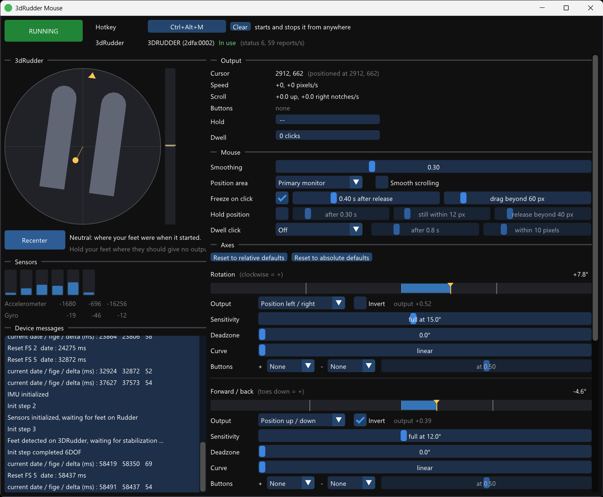

# 3dRudder Mouse

This is a Windows application that lets you control the mouse with a 3dRudder foot controller. Each of the 3dRudder's four axes (rotation, forward / back tilt, left / right tilt, up / down) can control the cursor or scroll. Each axis can also click mouse buttons when pushed past a threshold, and there's an optional dwell click.

_Please note it's only been tested with the PlayStation version of 3dRudder (the blue one). I don't know anything about the other versions._

There are two main modes of operation: relative mode ("Move") works kind of like a joystick, where holding the 3dRudder in some position keeps moving the cursor, absolute mode ("Position") works more like a mouse, where the position of the cursor on the screen corresponds directly to the orientation of the 3dRudder (if it doesn't move, the mouse cursor doesn't move).

For downloads see the [latest release](https://github.com/jfedor2/3drudder-mouse/releases/latest).

See also: [3dRudder HID Transmitter](https://github.com/jfedor2/3drudder-hid-transmitter), which turns the 3dRudder into a gamepad.

## Usage

Plug in the 3dRudder and run the program. It finds the 3dRudder by itself, and reconnects if it's unplugged and plugged back in. No software from the manufacturer has to be installed.

- **RUNNING / STOPPED** turns the mouse control on and off. It starts stopped.
- **Hotkey** does the same from anywhere, Ctrl+Alt+M by default. To change it, click the button showing it and press the new key combination (Esc cancels). It needs Ctrl, Alt, Shift or Win, except for the F-keys, Pause and Scroll Lock, which work alone. **Clear** removes it. If Windows or another program already uses the combination, it says so.
- The window icon shows the state. The left half is the 3dRudder: yellow when it's connected but not in use (feet not on it), green when it's in use. The right half is red when stopped, green when running. The whole circle is red when no 3dRudder is found.
- Put both feet on the 3dRudder and keep them still for a moment. The status goes to "In use", and the 3dRudder takes the current position of your feet as neutral. Nothing happens to the mouse when it's not in use, and any buttons held are released.
- The **top-down view** shows the feet turned by the rotation and the tilt as a yellow dot. The bar next to it is up / down.
- **Recenter** takes the current position as neutral, for when the rotation drifts or you want a different neutral. It's forgotten when you take your feet off, because the 3dRudder sets a new neutral itself when they go back on.
- **Output** shows the cursor position, speed, scrolling, buttons held and dwell progress.

### Mouse

- **Smoothing** steadies the axes when holding still, at the cost of a little lag. Fast movements are smoothed less. It matters most for Position.
- **Position area**: where the Position outputs put the cursor, the primary monitor or all monitors. Neutral is the middle of the area, full output on either side is its edge.
- **Freeze on click** (for the Position outputs) keeps the cursor where it was while any mouse button is down, so clicks don't turn into drags. It sees all clicks: the real mouse, other programs (like an autoclicker) and the 3dRudder's own buttons. It stays frozen for a moment **after release** (0.4 s by default), so the second click of a double click lands in the same place. To drag, move the position further than the **drag** distance from where it froze; the cursor then follows until the buttons are released. Moving that far after a click also ends the freeze right away. On by default.
- **Hold position** (for the Position outputs) is another way of keeping the cursor still, without needing to know about clicks. Off by default. When the position stays within the **still** distance for the **after** time, the cursor is held in place, and small movements don't move it. It follows again once the position moves more than the **release** distance from where it was held. It's a tradeoff: a smaller release distance allows smaller corrections, a larger one holds the cursor more firmly. **Output** shows when it's held.
- **Smooth scrolling** scrolls in fractions of a wheel notch. It's smoother in apps that support it, but some apps only react to whole notches.
- **Dwell click** clicks (left, double or right) when you hold the cursor still after moving it. It clicks once, then waits for the cursor to move again. **after** is how long to hold still, **within** is how far the cursor can wander and still count as still. It doesn't dwell while a button is held. Windows doesn't have a built-in dwell click for regular mice.

### Axes

Each axis has a bar with the current value (yellow marker), the deadzone (shaded), the points of full output (white lines), the button thresholds (orange ticks) and the output (blue).

- **Output**:
  - **Move left / right**, **Move up / down**: the axis sets how fast the cursor moves.
  - **Position left / right**, **Position up / down**: the axis sets where the cursor is in the position area. The cursor is only moved when the position changes, so you can still use the real mouse while your feet are still.
  - **Scroll up / down**, **Scroll left / right**: the axis sets how fast it scrolls.
  - The + side (clockwise, toes down, tilt right, up) goes right / up. Several axes can drive the same output, and they add up. If an axis is set to Position on one direction, Move on that direction is ignored.
- **Invert** swaps the + and - sides.
- **Sensitivity**: how far from neutral for full output. Lower = more sensitive.
- **Deadzone**: how far from neutral with no output.
- **Curve**: 1 is linear. Higher values give finer control near neutral and still reach full output at the same point.
- **Speed** (Move and Scroll): pixels or wheel notches per second at full output. Windows' pointer speed and "Enhance pointer precision" settings also apply to the cursor movement.
- **Buttons**: a mouse button for each side, held while the axis is past the threshold, which runs from 0 (just outside the deadzone) to 1 (full). The buttons work with or without an output.

By default, rotation moves the cursor left / right and forward / back moves it up / down (inverted, so toes down moves the cursor down).

Settings are saved automatically to `%APPDATA%\3drudder-mouse\3drudder-mouse\settings.json`.

Pass `--start` on the command line to start in the running state.

## Limitations

- Windows doesn't let it control windows of programs running as administrator unless it's also run as administrator. It can't control UAC prompts or the lock screen at all.
- Some games ignore programmatically generated mouse input.

## Protocol

See the [3dRudder HID Transmitter](https://github.com/jfedor2/3drudder-hid-transmitter) README for some information about the 3dRudder's USB protocol.

## License and acknowledgements

The software in this repository is licensed under the [MIT License](LICENSE).

The UI uses [Dear ImGui](https://github.com/ocornut/imgui) (MIT) and configuration uses [nlohmann/json](https://github.com/nlohmann/json) (MIT).
